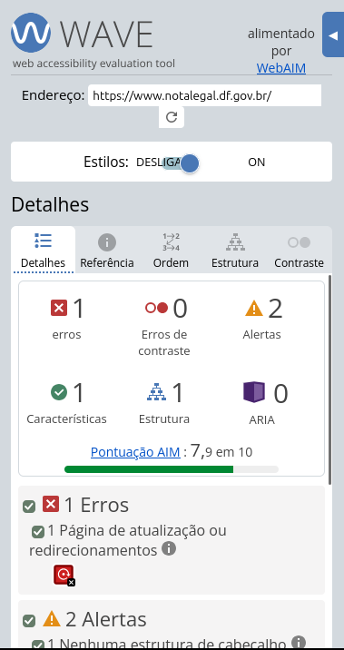
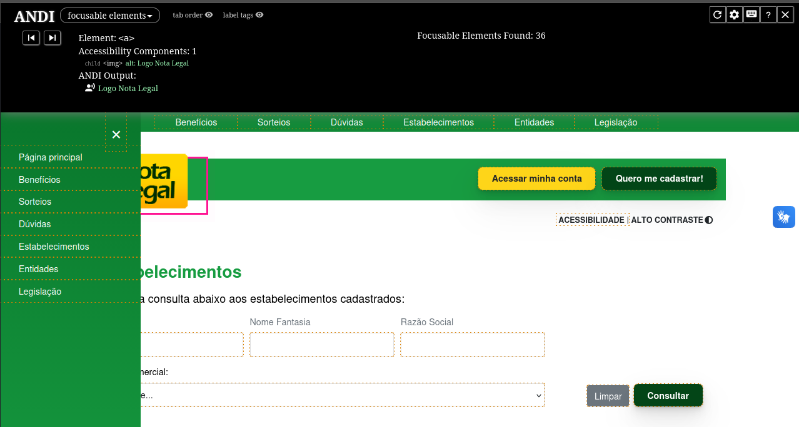
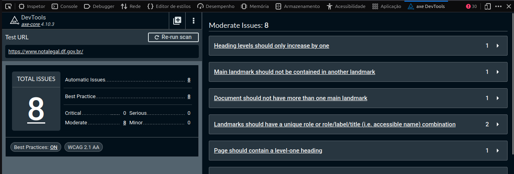
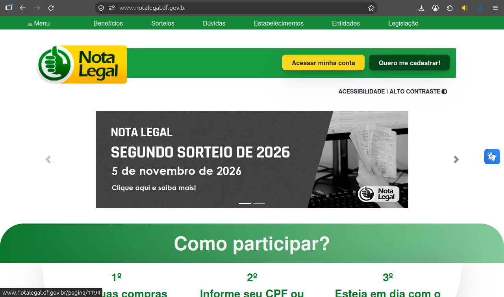
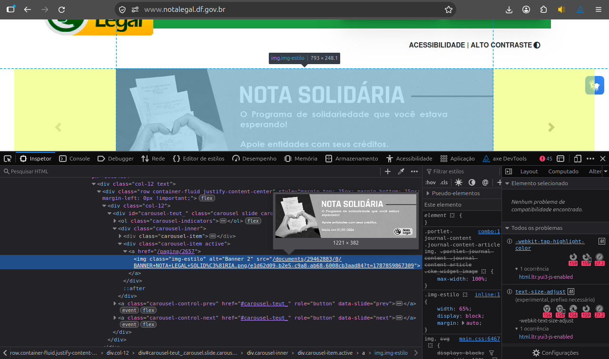
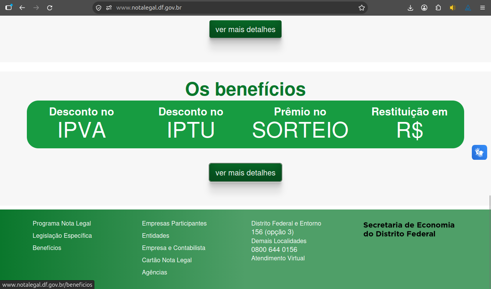
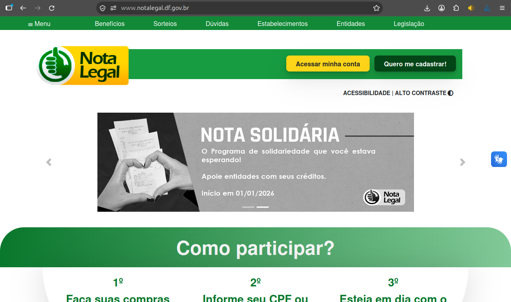
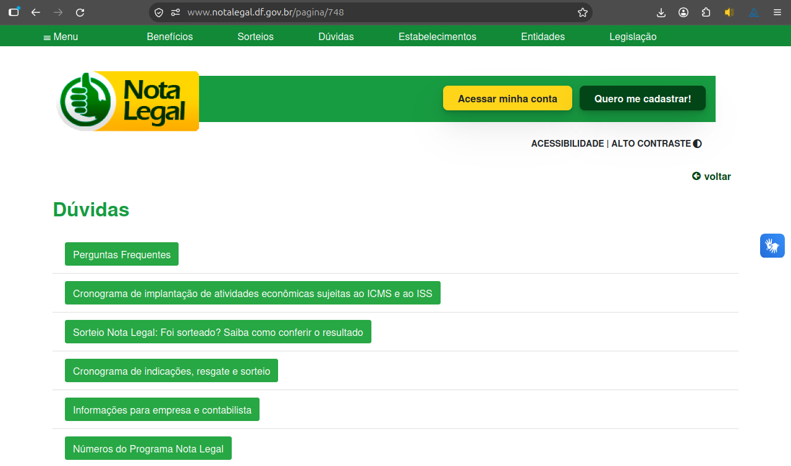
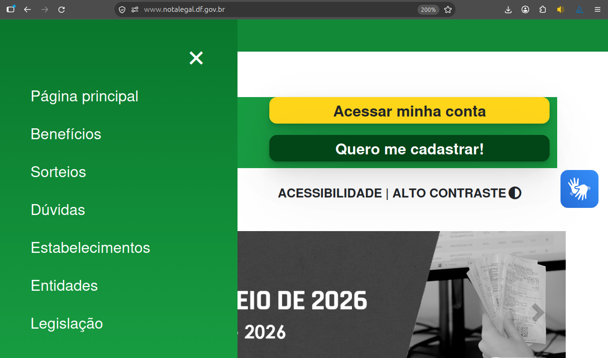
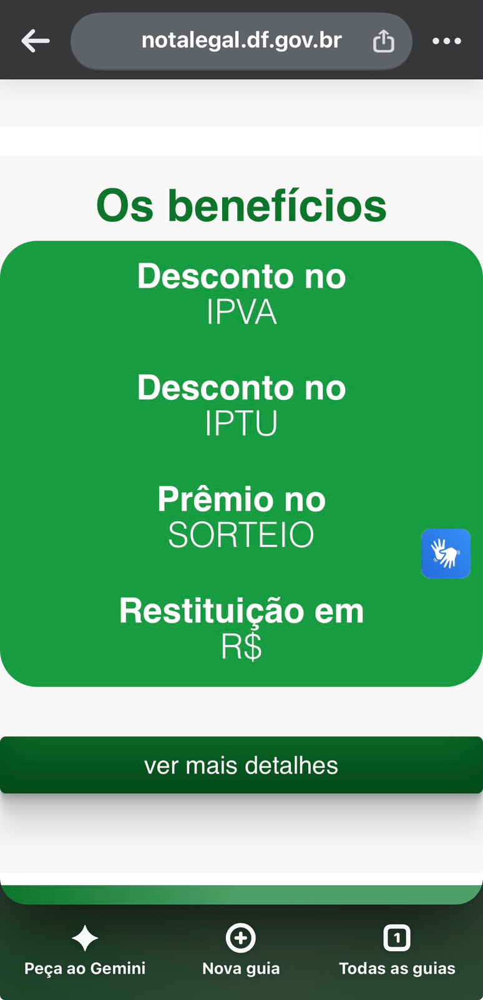

# Inspeção do Nota Legal

Esta página reúne a **avaliação por inspeção** do site [Nota Legal DF](https://www.notalegal.df.gov.br/), feita pela equipe com os checklists deste guia, três ferramentas automáticas e testes manuais. Ela complementa o [teste com usuário](resultados_avaliacao.md): a inspeção mostra o que viola a norma, e o teste mostra o que atrapalha quem usa o site de verdade.

!!! abstract "Resumo"
    **Conteúdo forte, desenvolvimento fraco.** Dos 28 critérios aplicados, **12 estão conformes, 7 parciais e 8 não conformes**. Quatro falhas são de **nível A da WCAG** (1.1.1, 2.1.1, 2.2.2 e 2.4.4), o mínimo exigido. Enquanto elas existirem, o portal não atende à Lei Brasileira de Inclusão (art. 63) nem à ABNT NBR 17225.

---

## Planejamento (DECIDE)

A avaliação foi planejada com o framework DECIDE (Rogers, Sharp e Preece, 2013).

| Etapa | Decisão |
| :--- | :--- |
| **Objetivo** | Verificar a conformidade do portal com a WCAG e com as heurísticas de Nielsen, identificando barreiras para pessoas com limitações visuais, motoras ou cognitivas. |
| **Métodos** | Inspeção por checklist (Gestão, Design, Desenvolvimento e Conteúdo), ferramentas automáticas (WAVE, ANDI e axe DevTools) e testes manuais de teclado, zoom de 200% e celular. |
| **Escopo** | Página inicial, menu principal e menu lateral, Estabelecimentos, Sorteios, fluxo de cadastro e opções de acessibilidade. |
| **Ética** | Inspeção da área pública, sem usuários e sem envio de dados pessoais reais. |
| **Base normativa** | WCAG 2.2, ABNT NBR 17225:2025, Lei Brasileira de Inclusão (art. 63) e e-MAG. |

### Perguntas da avaliação

1. **Q1.** Dá para navegar só pelo teclado, inclusive no Alto Contraste?
2. **Q2.** O foco é visível, o contraste é adequado e as imagens têm texto alternativo?
3. **Q3.** Links, títulos, landmarks e rótulos orientam o leitor de tela?
4. **Q4.** Erros, avisos e mudanças na tela são comunicados além do visual?
5. **Q5.** A pessoa sabe onde está dentro do site?

### Como classificamos

- **C** (conforme), **P** (parcialmente conforme), **NC** (não conforme) ou **NA** (não aplicável, como processos internos do órgão).
- Cada problema recebeu uma **severidade de 0 a 4** (escala de Nielsen: 0 não é problema, 1 cosmético, 2 menor, 3 grave, 4 catastrófico) e um esforço estimado de correção.

---

## Resultado por área

| Área | Critérios | Conformes | Parciais | Não conformes | Não aplicáveis |
| :--- | :---: | :---: | :---: | :---: | :---: |
| Conteúdo | 9 | 7 | 2 | 0 | 0 |
| Design | 9 | 5 | 3 | 1 | 0 |
| Desenvolvimento | 7 | 0 | 2 | 5 | 0 |
| Gestão de Projetos | 3 | 0 | 0 | 2 | 1 |
| **Total** | **28** | **12** | **7** | **8** | **1** |

??? note "Gestão de Projetos (3 critérios)"
    | Critério | Status | Evidência |
    | :--- | :---: | :--- |
    | Considerar acessibilidade desde a iniciação | NA | Processo interno do órgão, não verificável externamente. |
    | Aplicar princípios de desenho universal | NC | O texto alternativo dos banners é genérico (“Banner 1”) e há texto dentro das imagens. |
    | Conformidade com a LBI (art. 63) e a ABNT NBR 17225 | NC | Há falhas de nível A da WCAG (1.1.1, 2.1.1, 2.2.2 e 2.4.4). |

??? note "Design (9 critérios)"
    | Critério | Status | Evidência |
    | :--- | :---: | :--- |
    | Informar a localização do usuário (Heurística 1) | P | A etapa (“Passo 2 de 5”) só aparece no cadastro; o breadcrumb não marca a página atual. |
    | Design estético e minimalista (Heurística 8) | C | Só as informações relevantes à tarefa. |
    | Contraste de texto, mínimo 4,5:1 (WCAG 1.4.3) | C | O WAVE não detectou erros de contraste. |
    | Contraste de componentes, mínimo 3:1 (WCAG 1.4.11) | C | Botões e campos com contraste adequado na inspeção visual. |
    | Design responsivo, sem rolagem horizontal (WCAG 1.4.10) | P | Funciona no celular, mas as imagens ficam pequenas e as tabelas, apertadas. |
    | Mensagens de erro sugerem correção (WCAG 3.3.3) | NC | Aparece apenas “data inválida”, sem o formato esperado. |
    | Erros indicados por mais de um recurso (WCAG 3.3.1) | C | O campo com erro é indicado de forma clara. |
    | Texto ampliado até 200% (WCAG 1.4.4) | P | O menu superior perde conteúdo com o zoom de 200%. |
    | Não restringir a orientação da tela (WCAG 1.3.4) | C | Funciona em retrato e paisagem. |

??? note "Desenvolvimento (7 critérios)"
    | Critério | Status | Evidência |
    | :--- | :---: | :--- |
    | Navegação por teclado (WCAG 2.1.1) | P | Quase tudo é alcançável por Tab, exceto o Alto Contraste. |
    | Foco sempre visível (WCAG 2.4.7) | P | O indicador de foco tem cor próxima à do fundo. |
    | Evitar texto dentro de imagens (WCAG 1.4.5) | NC | Os banners trazem títulos e datas na própria imagem. |
    | Nomes de links claros (WCAG 2.4.4) | NC | Há links que mostram só “pagina” e um número, como /pagina/1194. |
    | Texto alternativo em imagens (WCAG 1.1.1) | NC | O atributo alt existe, mas diz apenas “Banner 1”. |
    | Anunciar mudanças dinâmicas (WCAG 4.1.2 e 4.1.3) | NC | Não foram encontradas regiões aria-live nem anúncios de mudanças. |
    | Pausar animações automáticas (WCAG 2.2.2) | NC | O carrossel da página inicial não pode ser pausado. |

??? note "Conteúdo (9 critérios)"
    | Critério | Status | Evidência |
    | :--- | :---: | :--- |
    | Linguagem simples e direta (WCAG 3.1.5) | C | Linguagem de fácil compreensão. |
    | Títulos, subtítulos e parágrafos curtos (WCAG 2.4.6) | C | Organização textual adequada. |
    | Uso semântico de h1 a h6 (WCAG 1.3.1) | P | O axe aponta que a página não tem título de nível 1. |
    | Ordem lógica de títulos | P | Um h4 (“156 (opção 3)”) aparece sem os níveis anteriores. |
    | Evitar siglas e termos técnicos (WCAG 3.1.3) | C | Termos claros para o público geral. |
    | Consistência terminológica | C | Os mesmos nomes para botões, seções e funções. |
    | Idioma da página (WCAG 3.1.1) | C | lang="pt-BR" no elemento html. |
    | Listas estruturadas (WCAG 1.3.1) | C | Estrutura de lista adequada. |
    | Título da aba descritivo (WCAG 2.4.2) | C | Título único e descritivo. |

---

## Ferramentas automáticas

| Ferramenta | Resultado | O que encontrou |
| :--- | :---: | :--- |
| **WAVE** (WebAIM) | 7,9 de 10 (AIM) | 1 erro (atualização automática da página por meta refresh), 0 erros de contraste e 2 alertas. |
| **ANDI** | 36 elementos focalizáveis | O Alto Contraste não está entre os elementos alcançáveis pelo Tab. |
| **axe DevTools** (axe-core 4.10.3) | 8 problemas moderados, 0 críticos | Página sem h1, salto para h4, dois landmarks main, menus sem nome próprio e conteúdo fora de landmarks (widget VLibras). |

=== "WAVE"
    { width="320" }

=== "ANDI"
    

=== "axe DevTools"
    

!!! warning "O que as ferramentas não viram"
    Nenhuma ferramenta apontou o **texto alternativo genérico**, o **foco quase invisível** ou o **carrossel sem pausa**. Esses problemas, os mais graves, só apareceram na inspeção manual. Por isso combinamos os dois métodos.

---

## Os três problemas graves

Os três têm **severidade 3 (grave)** e **esforço de correção baixo**.

### 1. Banners que o leitor de tela não lê

**WCAG 1.1.1 (nível A) e 1.4.5 (nível AA).** Os banners têm texto alternativo genérico, como “Banner 1”, e o título e as datas estão desenhados dentro da imagem. Quem usa leitor de tela não sabe se o banner anuncia um sorteio, um aviso ou um evento.



*Banner da página inicial: título e data desenhados na imagem.*

??? info "Ver o código do banner no inspetor"
    

```html
<!-- Hoje -->


<!-- Proposto: o alt repete a mensagem do banner -->


<!-- Imagem puramente decorativa -->

```

O ideal é tirar o texto de dentro da imagem e escrevê-lo em HTML, sobre a imagem ou ao lado dela.

### 2. Quem usa teclado se perde na página

**WCAG 2.4.7 (AA) e 2.1.1 (A) · Heurística 7.** O contorno de foco tem cor próxima à do fundo: ao apertar Tab, quase não se vê onde se está. E a opção de **Alto Contraste**, feita para quem tem baixa visão, não é alcançada pelo teclado.



*Captura com o foco do teclado em um elemento da página. Dá para ver onde ele está?*

```css
a:focus-visible, button:focus-visible, input:focus-visible, select:focus-visible {
  outline: 3px solid #0b3d91;
  outline-offset: 2px;
  box-shadow: 0 0 0 2px #ffffff; /* mantém o foco visível também sobre fundo escuro */
}
```

```html
<!-- Botão nativo: alcançável por Tab e acionável por Enter ou Espaço -->
<button type="button" id="alto-contraste" aria-pressed="false">Alto contraste</button>
```

O foco precisa de contraste mínimo de 3:1 com as cores ao redor, sobre os fundos verde e branco do portal.

### 3. Um carrossel que não para

**WCAG 2.2.2 (A) e 4.1.3 (AA) · Heurística 3.** O carrossel da página inicial troca sozinho e só tem setas, sem botão de pausa. Movimento automático que dure mais de 5 segundos precisa poder ser pausado, parado ou ocultado. Também não encontramos regiões aria-live anunciando as mudanças.



*Carrossel da página inicial: só setas, nenhum controle de pausa.*

```html
<section aria-roledescription="carrossel" aria-label="Destaques do Nota Legal">
  <button type="button" id="alternar" aria-label="Pausar rotação dos destaques">Pausar</button>
  <div id="slides" aria-live="off">
    <div role="group" aria-roledescription="slide" aria-label="1 de 4"> ... </div>
  </div>
</section>
```

```js
// Enquanto o carrossel gira, aria-live fica desligado; ao pausar, passa a "polite".
const botao = document.getElementById('alternar');
const slides = document.getElementById('slides');
let rodando = true;
botao.addEventListener('click', () => {
  rodando = !rodando;
  rodando ? iniciarAutoplay() : clearInterval(autoplay); // funções do carrossel existente
  slides.setAttribute('aria-live', rodando ? 'off' : 'polite');
  botao.textContent = rodando ? 'Pausar' : 'Retomar';
});
```

Padrão de referência: [WAI-ARIA Authoring Practices – Carousel](https://www.w3.org/WAI/ARIA/apg/patterns/carousel/).

---

## Outras não conformidades

| Problema | Critério | Sev. | Correção |
| :--- | :--- | :---: | :--- |
| Links só com o número da página (“/pagina/1194”) | WCAG 2.4.4 (A) · H2 | 3 | Texto que diz o destino, como “Regulamento do sorteio” |
| Erro “data inválida” sem dizer o formato | WCAG 3.3.3 (AA) · H9 | 2 | “Formato de data inválido. Use DD/MM/AAAA.” |
| Breadcrumb não marca a página atual | Heurística 1 | 2 | `aria-current="page"` e estilo próprio no último item |
| Página sem h1 e salto direto para h4 | WCAG 1.3.1 e 2.4.6 | 2 | Um h1 por página e níveis em sequência |
| Menu superior perde conteúdo com zoom de 200% | WCAG 1.4.4 (AA) | 2 | Unidades relativas e menu recolhível |
| No celular, imagens pequenas e tabelas apertadas | WCAG 1.4.10 (AA) | 2 | `max-width: 100%` nas imagens e rolagem só dentro da tabela |
| Dois landmarks main e menus sem nome próprio | Boas práticas (axe) | 2 | Um único main e `aria-label` distinto em cada nav |

=== "Link genérico"
    

=== "Zoom de 200%"
    

=== "Celular"
    { width="320" }

---

## Heurísticas de Nielsen: inspeção e teste

A tabela junta os dois métodos. **Violada**: a inspeção encontrou violação com evidência, mesmo que a participante do teste não tenha sentido o problema. **Ressalva**: a inspeção aprovou, mas o [teste com usuário](resultados_avaliacao.md) mostrou um problema.

| Heurística | Inspeção | Teste com usuário | Resultado |
| :--- | :--- | :--- | :--- |
| H1 · Visibilidade do status | Etapas só no cadastro; breadcrumb sem a página atual | Não avaliada | Parcial |
| H2 · Correspondência com o mundo real | Linguagem simples, mas links “página 1194” | Editais atualizados | Parcial |
| H3 · Controle e liberdade | Carrossel sem pausa | Navegação sem bloqueios | Violada |
| H4 · Consistência e padrões | Nomes consistentes | FAQ abre outro domínio, com outro visual | Ressalva (teste) |
| H5 · Prevenção de erros | Formulários validam a data | Barra superior some ao rolar | Ressalva (teste) |
| H6 · Reconhecimento em vez de memorização | Opções visíveis nos menus | Botão de cadastro não percebido | Ressalva (teste) |
| H7 · Flexibilidade e eficiência | Alto Contraste sem teclado | Informação achada rápido | Violada |
| H8 · Design estético e minimalista | Visual limpo, sem erros de contraste | Visual limpo | Atendida |
| H9 · Ajudar a corrigir erros | “Data inválida” sem o formato | Nenhum erro exigiu ajuda | Violada |
| H10 · Ajuda e documentação | Sem ajuda focada na tarefa | Atendimento achado em 8 s | Divergente |

**Resultado: 3 violadas, 3 com ressalvas do teste, 2 parciais, 1 atendida e 1 divergente.** Na H10, a inspeção procurou uma ajuda organizada por tarefa e não achou; a participante só precisou do atendimento, que está no rodapé.

---

## Respostas às perguntas da avaliação

| Pergunta | Resposta |
| :--- | :--- |
| Q1. Navegação só pelo teclado | **Parcial:** quase tudo é alcançável, exceto o Alto Contraste. |
| Q2. Foco, contraste e texto alternativo | Contraste de texto sem erros; foco de baixa visibilidade; alt genérico e texto dentro das imagens. |
| Q3. Semântica para o leitor de tela | **Não plenamente:** sem h1, salto de nível, dois landmarks main, menus sem nome e links genéricos. |
| Q4. Erros e mudanças além do visual | O erro indica o campo com cor e texto, mas não sugere correção; mudanças dinâmicas não são anunciadas. |
| Q5. Saber onde está | **Parcial:** etapa indicada só no cadastro; breadcrumb sem a página atual. |

## Limitações

- Inspeção feita pela equipe, sem participação de pessoas com deficiência.
- Avaliação em novembro de 2026; o portal pode ter mudado desde então.
- Escopo restrito às páginas e aos fluxos listados no planejamento.
- Componentes de terceiros, como o widget VLibras, estão fora do controle da equipe do portal.
- As ferramentas automáticas cobrem só parte dos critérios da WCAG e podem divergir entre si.

As recomendações que juntam esta inspeção e o teste com usuário estão em [Recomendações e conclusão](conclusao.md).

## Referências

- BARBOSA, S. D. J.; SILVA, B. S. *Interação Humano-Computador*. Rio de Janeiro: Elsevier, 2010.
- BRASIL. [Lei nº 13.146, de 6 de julho de 2015](https://www.planalto.gov.br/ccivil_03/_ato2015-2018/2015/lei/l13146.htm) (Lei Brasileira de Inclusão).
- NIELSEN, J. [10 Usability Heuristics for User Interface Design](https://www.nngroup.com/articles/ten-usability-heuristics/). Nielsen Norman Group.
- ROGERS, Y.; SHARP, H.; PREECE, J. *Design de Interação: além da interação humano-computador*. 3. ed. Porto Alegre: Bookman, 2013.
- W3C. [Web Content Accessibility Guidelines (WCAG) 2.2](https://www.w3.org/TR/WCAG22/), 2023.
- Ferramentas: [WAVE](https://wave.webaim.org/), [ANDI](https://www.ssa.gov/accessibility/andi/help/install.html) e [axe DevTools](https://www.deque.com/axe/devtools/).
